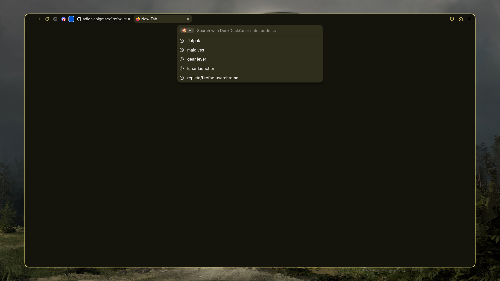
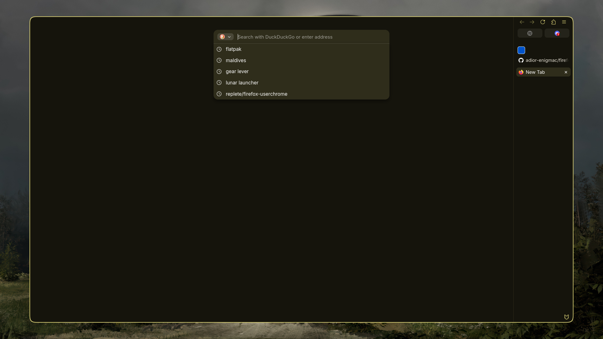

# firefox-revamp

A minimal Firefox UI made with `userChrome.css` and one script. It builds on stock Firefox, so the built-in sidebar, tabs and menus keep working.

## Layout

Horizontal tabs:



```
[◀][▶][⟳][ tabs ………………………………… ][pinned ext][🧩][☰]
```

- Everything is in one row, and the tabs fill the space between the buttons.
- The address bar opens as a floating box near the top of the window, with suggestions below it. It opens on Ctrl+L, on a new tab, or when you double-click a tab.
- Double-click empty space in the tab strip to open a new tab.
- Ctrl+Alt+Z hides the top bar and shows it again.

Vertical tabs:



```
[◀][▶][⟳][🧩][☰]
[ tabs … ]
          [pinned ext]
```

- The buttons move into Firefox's sidebar and wrap to fit its width.
- The bookmarks and history sidebar (Ctrl+B / Ctrl+H) works as usual.
- Ctrl+Alt+Z hides the sidebar and shows it again, expanded or collapsed as it was.
- Drag the sidebar narrower than 150px and it collapses to icons. Expanding it again restores the width it had before.

Switching between the two puts every button back in place.

Both layouts:

- Ctrl+Tab shows a preview of every open tab, centred on the screen. The arrow keys move through the grid.
- In fullscreen, move the mouse to the top edge to bring the top bar back.
- Tools → Reveal Hidden Bars on Hover does the same outside fullscreen: a hidden top bar comes back from the top edge, and a hidden sidebar from its side of the window. Both hide again when the mouse moves back into the page.

## Requirements

- Firefox 159. Newer versions should work, but a Firefox update can change the elements this styles.
- Linux for the install script. For macOS and Windows, see *Manual install*.
- The distro package or the mozilla.org tarball. Snap and Flatpak don't work, because their install folder is read-only.

## Install

Quit Firefox, then run:

```sh
curl -fsSL https://raw.githubusercontent.com/adior-enigmac/firefox-revamp/main/install.sh | bash
```

The script:

1. Installs the [fx-autoconfig](https://github.com/MrOtherGuy/fx-autoconfig) script loader (`config.js`, `defaults/pref/config-prefs.js`) into Firefox's install folder. This may ask for your sudo password.
2. Moves your current `chrome/` folder to `chrome.backup-<date>/` and installs this repo's `chrome/` folder into your default profile.
3. Adds the required prefs to your profile's `user.js`. Existing lines are kept.
4. Clears Firefox's startup cache.

To pass options, add them after `bash -s --`:

```sh
curl -fsSL https://raw.githubusercontent.com/adior-enigmac/firefox-revamp/main/install.sh | bash -s -- --uninstall
```

| Option | Effect |
|---|---|
| `--profile DIR` | Install into this profile folder instead of the default one. |
| `--autoconfig-only` | Reinstall only the script loader. |
| `--privacy-prefs` | Also apply `extras/privacy-performance.user.js`. |
| `--uninstall` | Remove what the script installed. |
| `--yes` | Don't ask for confirmation. |

To use vertical tabs, go to Settings → General → Browser layout, or set `sidebar.verticalTabs` to `true` in `about:config`.

## Manual install

1. Open `about:support` and click *Open Folder* next to Profile Folder.
2. Copy `chrome/` into that folder, then copy `vendor/fx-autoconfig/profile/chrome/utils/` to `<profile>/chrome/utils/`.
3. Copy `vendor/fx-autoconfig/program/config.js` and `vendor/fx-autoconfig/program/defaults/pref/config-prefs.js` into Firefox's install folder, keeping the paths:
   - Linux: usually `/usr/lib/firefox/`
   - Windows: `C:\Program Files\Mozilla Firefox\`
   - macOS: `Firefox.app/Contents/Resources/`
4. Add the prefs from `user.js` to `<profile>/user.js`, or set them in `about:config`.
5. In `about:support`, click *Clear startup cache…*, then restart Firefox.

## Optional prefs

`extras/privacy-performance.user.js` turns off telemetry and sponsored content, makes some privacy settings stricter, and tunes Firefox for a machine with little RAM. The UI doesn't need it.

It also turns off Safe Browsing and the add-on blocklist, disables OCSP, and sets DNS-over-HTTPS with no fallback. The header of the file lists every change like this. Install it with `--privacy-prefs`, or copy the lines you want into `<profile>/user.js`.

## If the script stops loading

The script loader's files live in Firefox's install folder, not your profile. Normal updates leave them alone, but reinstalling Firefox or switching to another Firefox package can remove them. If tabs move back to their own row or the sidebar buttons are missing, quit Firefox and run:

```sh
curl -fsSL https://raw.githubusercontent.com/adior-enigmac/firefox-revamp/main/install.sh | bash -s -- --autoconfig-only
```

## Updating

Run the install command again. Each run backs up your previous `chrome/` folder.

## Customising

- Accent colour: `#00ddff` in `chrome/userChrome.css`.
- Address bar width: `--uc-pill-w` in `chrome/revamp.css`.
- Sidebar layout: section E of `chrome/revamp.css`, and `syncControlsHome()` in `chrome/JS/revamp.uc.js`.

Firefox only reads these files at startup, so restart it fully after a change.

## Troubleshooting

- Nothing changed: check that `toolkit.legacyUserProfileCustomizations.stylesheets` is `true`, and that you installed into the profile Firefox is using (listed in `about:support`).
- The styling loads but the layout is wrong: the script isn't running. Run the installer with `--autoconfig-only`, then restart Firefox.
- The script logs its actions to the Browser Console (Ctrl+Shift+J) with the prefix `[revamp]`.

## Credits

- `chrome/firefox-csshacks/chrome/oneline_toolbar.css`: [MrOtherGuy/firefox-csshacks](https://github.com/MrOtherGuy/firefox-csshacks), MPL-2.0, unmodified.
- `vendor/fx-autoconfig/`: [MrOtherGuy/fx-autoconfig](https://github.com/MrOtherGuy/fx-autoconfig) 0.10.16, MPL-2.0.

## License

[MPL-2.0](LICENSE). The vendored files in `chrome/firefox-csshacks/` and `vendor/fx-autoconfig/` keep their own MPL-2.0 licenses.
